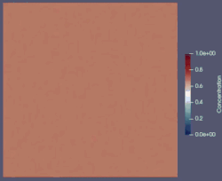

# Phase Separation: Cahn-Hilliard Equation

## Cahn-Hilliard

This example solves the **Cahn-Hilliard equation**, which models the process of phase separation (spinodal decomposition) in binary fluids or alloys. Starting from a highly mixed state with microscopic perturbations, the system spontaneously separates into distinct pure domains over time to minimize the total free energy.

This implementation uses a **coupled mixed formulation**, solving simultaneously for the concentration field $c$ and the chemical potential $\mu$.

**Note: Unlike most of other rest of examples, this will use a JAX AD instead of the custom one. It is way faster specially for time-dependent problems. One must just use jax functions instead of numpy in the weak form definition**

---

## Governing equations

The Cahn-Hilliard equation is a fourth-order nonlinear partial differential equation. It is split into two second-order equations for the concentration $c$ and the chemical potential $\mu$:

$$
\frac{\partial c}{\partial t} = \nabla \cdot (M \nabla \mu) \qquad \text{in } \Omega
$$

$$
\mu = f'(c) - \lambda \nabla^2 c \qquad \text{in } \Omega
$$

where:
- $M$ is the mobility.
- $\lambda$ is the surface energy parameter (controls the interface thickness).
- $f(c)$ is the double-well free energy potential. In this example, we use:

$$f(c) = 100 c^2 (1-c)^2$$

The derivative of the potential with respect to the concentration is:

$$f'(c) = 100 (2c(1-c)^2 - 2c^2(1-c))$$

Natural homogeneous Neumann (no-flux) boundary conditions are used for both $c$ and $\mu$:

$$M \nabla \mu \cdot \mathbf{n} = 0, \qquad \nabla c \cdot \mathbf{n} = 0 \qquad \text{on } \partial\Omega$$

---

## Weak formulation

To bypass the requirement of $C^1$-continuous elements for a fourth-order PDE, we use a mixed weak formulation. After multiplying by the test functions and integrating the appropriate terms by parts, we find $(c, \mu) \in H^1 \times H^1$ such that for all test functions $(q, v) \in H^1 \times H^1$:

1. **Concentration Equation:**

$$
\int_\Omega \frac{c - c_{\text{old}}}{\Delta t} q d\Omega + \int_\Omega M \nabla \mu_{\text{mid}} \cdot \nabla q d\Omega = 0
$$

Where 

$$\nabla \mu_{\text{mid}} = (1 - \theta) \nabla \mu_{\text{old}} + \theta \nabla \mu$$

*(We used a Crank-Nicolson / $\theta$ -method approach  for the time-integration of the chemical potential gradient)*

2. **Chemical Potential Equation:**

$$
\int_\Omega \mu v d\Omega - \int_\Omega f'(c) v d\Omega - \int_\Omega \lambda \nabla c \cdot \nabla v \; d\Omega = 0
$$

Since the framework uses automatic differentiation for the Jacobian, we assemble these directly into the nonlinear residual vector.

---

## Discretization

- **Mesh type:** Structured rectangular grid
- **Element:** Quad4
- **Function space:** Coupled Mixed Space ($V_c \times V_\mu$), where both $V_c \subset H^1$ and $V_\mu \subset H^1$
- **Time Integration:** $\theta$-method (Crank-Nicolson when $\theta=0.5$)
- The simulated domain is the unit square
- Instead of the custom AD that is used on most of other examples, on this we used JAX.

---

## Implementation details

The full implementation can be found in [example_cahn.py](./example_cahn.py).

We begin with the necessary imports, using the JAX-based `MixedAssembler` for AD compilation from `assembler_jax`:

```python
import numpy as np
import os
import time
import jax.numpy as jnp

from fem_engine.mesh import create_rectangle_mesh, FunctionSpace, MixedFunctionSpace
from fem_engine.element import Quad4
from fem_engine.assembler_jax import MixedAssembler
from fem_engine.fem_solver import solve_newton_raphson
from fem_engine.postprocess import export_vtu
```

Next, we define the spatial parameters, time-stepping settings, and material constants:

```python
# 1. PARAMETERS
L, W = 1.0, 1.0
n_x, n_y = 96, 96

dt = 5.0e-6
theta = 0.5
lmbda = 1.0e-2
M = 1.0
```

The weak form is defined to handle both equations simultaneously. The historical fields (c_old, mu_old) and parameters are extracted from the global state:

```python
# 2. WEAK FORM
def cahn_hilliard_weak_form(mapped, pos_gp, e, state):
    """
    Coupled Mixed Formulation for Cahn-Hilliard.
    mapped[0] -> Concentration c
    mapped[1] -> Chemical potential mu
    """
    (N_c, B_c, c, grad_c) = mapped[0]
    (N_mu, B_mu, mu, grad_mu) = mapped[1]

    # Extract historical mixed state fields passed via global_params
    c_old, grad_c_old = state['U_old'][0]
    mu_old, grad_mu_old = state['U_old'][1]
    
    # Extract constants
    dt_state = state['dt']
    theta_state = state['theta']
    lmbda_state = state['lmbda']
    M_state = state['M']

    c_val = c[0]
    mu_val = mu[0]
    c_old_val = c_old[0]
    
    grad_c = grad_c.flatten()
    grad_mu = grad_mu.flatten()
    grad_mu_old = grad_mu_old.flatten()

    # Theta-method (Crank-Nicolson) for the chemical potential gradient
    grad_mu_mid = (1.0 - theta_state) * grad_mu_old + theta_state * grad_mu
    
    # 1. First Equation: Concentration
    transient_c = N_c * (c_val - c_old_val) / dt_state
    diffusion_c = M_state * jnp.dot(B_c.T, grad_mu_mid)
    R_c = transient_c + diffusion_c

    # 2. Second Equation: Chemical Potential
    dfdc = 100.0 * (2.0 * c_val * (1.0 - c_val)**2 - 2.0 * c_val**2 * (1.0 - c_val))
    
    term1_mu = N_mu * mu_val
    term2_mu = -N_mu * dfdc
    term3_mu = -lmbda_state * jnp.dot(B_mu.T, grad_c)
    R_mu = term1_mu + term2_mu + term3_mu

    return [R_c, R_mu]
```

In the main block, we generate the mesh, initialize the mixed function spaces, and set the random initial conditions required to trigger phase separation:

```python
mesh = create_rectangle_mesh(L=L, W=W, n_x=n_x, n_y=n_y, x0=0.0, y0=0.0)

V_c = FunctionSpace(mesh, Quad4(), n_components=1)
V_mu = FunctionSpace(mesh, Quad4(), n_components=1)
V = MixedFunctionSpace([V_c, V_mu])

assembler = MixedAssembler(V, cahn_hilliard_weak_form, quad_degree=2)

np.random.seed(42)
U_n = np.zeros(V.ndofs)
c_dofs = np.arange(V_c.ndofs)

def initial_c(x, y):
        return 0.63 + 0.02 * (0.5 - np.random.rand())

U_n[c_dofs] = interpolate_to_nodes(V_c, initial_c)
```
Finally, we step through time. Boundary conditions are bypassed since natural Neumann conditions are automatically satisfied by the weak form. We are using `CachedVTUExporter` instead of `export_vtu`, which actually calculates the basis fun, jacobian, etc ONCE, making it faster than export_vtu (our mesh doesn't move).

```python
def apply_bcs(R, K, U):
    return R, K

# Time loop definition
n_steps = 300
t_end = n_steps * dt
current_time = 0.0
step = 0

# Export initial state (Step 0)
c_sol, mu_sol = V.split(U_n)
from fem_engine.postprocess import CachedVTUExporter
exporter = CachedVTUExporter(V_c, field_name="Concentration")
exporter.export(c_sol, f"results_cahn_hilliard/cahn_hilliard_{step:04d}.vtu")

print(f"\n--- Starting Cahn-Hilliard Mixed JAX Solver ({n_x}x{n_y} grid) ---")

while current_time < t_end:
    step += 1
    current_time += dt
    
    print(f"\nStep {step}/{n_steps} | Time: {current_time:.2e}s")
    
    # Package the historical mixed state for the JAX assembler
    # 'U_old' with size matching V.ndofs automatically maps directly to all spaces
    global_params = {
        'U_old': U_n,
        'dt': dt,
        'theta': theta,
        'lmbda': lmbda,
        'M': M
    }
    
    # Lock in historical inputs for the NR routine callback
    def current_assembly(U_guess):
        return assembler.assemble(U_guess, global_params=global_params)
        
    start_solve = time.time()
    
    # Non-linear Newton solve for the Mixed Formulation
    U_next = solve_newton_raphson(U_n.copy(), current_assembly, apply_bcs, nr_tol=1e-6, max_iter=10)
    
    print(f"-> Newton converged in {time.time() - start_solve:.3f}s")
    
    # Update history
    U_n = U_next.copy()
    
    # Export frames
    c_sol, mu_sol = V.split(U_n)
    exporter.export(c_sol, f"results_cahn_hilliard/cahn_hilliard_{step:04d}.vtu")
```

And for these time steps we get:

